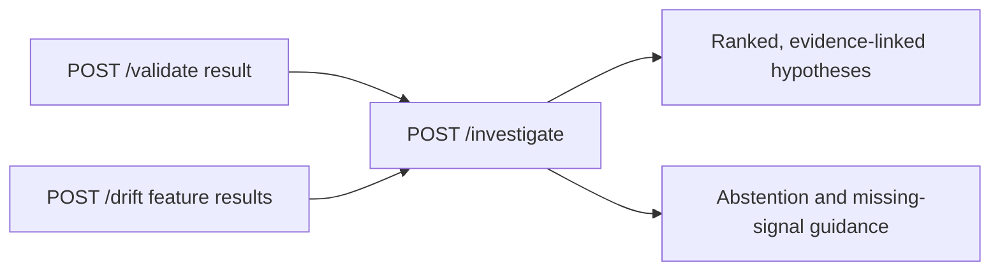

# ML Observability

A production-oriented ML observability service for detecting numerical data drift, evaluating detector behavior, and supporting evidence-based incident triage.

The project emphasizes reproducible evaluation, explicit limitations, automated testing, and a clean separation between drift detection and API delivery.

## Features

- Numerical drift detection using the two-sample Kolmogorov–Smirnov (KS) test.
- Benjamini–Hochberg false-discovery-rate correction across evaluated numerical features.
- Input validation and explicit handling of insufficient samples.
- FastAPI endpoints for validation, drift analysis, failure investigation, and health checks.
- Deterministic ML failure investigation from supplied schema and drift findings.
- Synthetic evaluations with known labels and multiple distribution-change scenarios.
- Multi-seed evaluation with 95% Wilson confidence intervals for selected metrics.
- Automated tests, linting, and formatting checks.

## Architecture

The service separates the detector from its API layer:

1. **Drift detection:** compares reference and current numerical feature distributions.
2. **Statistical correction:** adjusts feature-level significance decisions for multiple testing.
3. **API layer:** exposes detection results through typed HTTP endpoints.
4. **Evaluation layer:** measures detector behavior against synthetic scenarios with known ground truth.
5. **Tests and quality checks:** validate expected behavior, input handling, reproducibility, and regression safety.

The detector does not automatically retrain, modify, or deploy models. Drift alerts are signals for further investigation, not proof of model degradation or root cause.

The failure investigator ranks only schema/contract violations, observed missingness, and
feature distribution shifts supported by supplied results from this service. It is a
diagnostic layer over evidence, not a causal model or a quality monitor. Prediction changes,
model versions, pipeline health, labels, and outcome metrics are not currently collected.

## ML Failure Investigator

`POST /investigate` accepts a bounded list of normalized observations derived from the
existing `/validate` and `/drift` outputs. The caller adds a `kind` and stable, unique
`evidence_id` to each observation and copies the `/drift` response's top-level `alpha` onto
each feature result. It does not access historical incidents or run detectors itself. The
caller must associate supplied evidence with the same analysis window. The request supports
at most 200 evidence records, 100 columns
per schema result, and 128-character feature or column names. Unknown fields and signal kinds
are rejected with HTTP 422; the existing 2 MB request-body limit applies.

Example request for a synthetic multi-signal incident:

```json
{
  "evidence": [
    {
      "kind": "feature_drift",
      "evidence_id": "drift-2026-10-25-001",
      "feature": "account_age_days",
      "status": "evaluated",
      "drift_detected": true,
      "adjusted_p_value": 0.004,
      "alpha": 0.05
    },
    {
      "kind": "feature_drift",
      "evidence_id": "drift-2026-10-25-002",
      "feature": "transaction_amount",
      "status": "evaluated",
      "drift_detected": true,
      "adjusted_p_value": 0.012,
      "alpha": 0.05
    },
    {
      "kind": "schema_validation",
      "evidence_id": "validation-2026-10-25-001",
      "missing_columns": ["campaign_id"],
      "unexpected_columns": [],
      "missing_values": {"region": 12}
    }
  ]
}
```

Send it to the local service with:

```powershell
$body = @'
{"evidence":[{"kind":"feature_drift","evidence_id":"drift-001","feature":"account_age_days","status":"evaluated","drift_detected":true,"adjusted_p_value":0.004,"alpha":0.05},{"kind":"feature_drift","evidence_id":"drift-002","feature":"transaction_amount","status":"evaluated","drift_detected":true,"adjusted_p_value":0.012,"alpha":0.05},{"kind":"schema_validation","evidence_id":"validation-001","missing_columns":["campaign_id"],"unexpected_columns":[],"missing_values":{"region":12}}]}
'@
Invoke-RestMethod -Method Post -Uri http://127.0.0.1:8000/investigate `
  -ContentType 'application/json' -Body $body
```

The result contains a deterministic `analysis_id`, diagnostic contract version, ranked
hypotheses, evidence references, supporting and contradictory observations, a `conflicted`
flag, heuristic score, evidence-strength label, and missing signal recommendations. The current supported
hypotheses are:

| Hypothesis | Required supplied observation |
|---|---|
| `feature_distribution_shift` | An evaluated `/drift` feature result with `drift_detected: true` |
| `schema_contract_violation` | Missing or unexpected columns from `/validate` |
| `missingness` | One or more positive null counts from `/validate` |

No hypothesis is emitted for an unevaluated drift result, a clean schema result, or missing
evidence. Contradictory decisions for the same feature are both cited and mark that
hypothesis as conflicted. The investigator abstains when a top-ranked hypothesis is
conflicted, including a conflicted candidate tied for the top score. A conflict confined to
a lower-ranked hypothesis remains visible without suppressing a stronger independent finding.
When multiple causes are independently supported, all are returned; equal scores use the
fixed order `feature_distribution_shift`, `schema_contract_violation`, `missingness`.
An `analysis_id` is a stable hash of the normalized supplied evidence, not a persisted
incident identifier.

In this synthetic example, the two distinct drifted features produce a score of five for
`feature_distribution_shift`. The missing column and null count each produce a score of four
for `schema_contract_violation` and `missingness`; their tie uses the documented category
order. The response therefore ranks feature shift first while retaining all three supported
findings. This ordering reflects the heuristic only and does not establish that drift caused
model degradation.

Scores are rule-based heuristic points, not probabilities. Four points represent the first
distinct supporting feature/column, with one additional point per further distinct scope,
capped at ten. Each contradictory reference subtracts three points. Repeated findings about
the same scope do not increase the score. Strength labels describe this rule support only:
`limited` for conflict or a score below four, `moderate` for scores four through seven and
for a score of eight or more with fewer than two distinct evidence records, and `strong` for
a score of eight or more supported by at least two distinct evidence records. The labels have
not been statistically calibrated. Ties are resolved
deterministically and do not hide independently supported hypotheses. The investigator
abstains when no supported finding exists or when a conflicted hypothesis is tied for or
above the top rank.

### Investigator evaluation

Run the deterministic synthetic scenarios and write machine-readable JSON when desired:

```powershell
python scripts/evaluate_investigator.py --seed 42
python scripts/evaluate_investigator.py --seed 42 --json-output investigator-results.json
```

The ten scenarios cover single feature shift, missingness, schema failure, two unsupported
signal families (prediction anomaly and model-version change), simultaneous findings, equal
score co-occurring findings, conflicting same-feature results, insufficient samples, and
normal operation. Synthetic tabular inputs are passed through the current schema and drift
detectors; the unsupported cases deliberately supply no unsupported signal.

For seed `42`, single-target top-1 accuracy was `3/3`; top-3 hit rate for multi-cause cases
was `2/2`; mean reciprocal rank was `1.00` over five rankable scenarios; abstention precision
and recall were both `1.00` (`5/5` each); normal-operation false-positive diagnosis rate was
`0/1`; evidence-grounding violations were `0/10` references; and unsupported-category
diagnoses were `0/2` unsupported scenarios. Each metric denominator is printed and included
in JSON. Abstention metrics treat the five conflicting, unsupported,
insufficient, and normal scenarios as expected abstentions; rank metrics include the three
single-cause and two multiple-cause scenarios. The unranked baseline orders the same
supported hypotheses by category name, so it had identical top-1, top-3, and MRR results on
this fixture. This small, hand-authored synthetic suite establishes contract behavior only;
it does not show improved diagnostic quality on real incidents or representative production
data.

### Diagnostic data flow



The supplied findings are claims from the caller and are not authenticated by the investigator.
The feature distribution hypothesis reports a statistical difference, not its cause or an
impact on model quality. Model quality degradation or concept drift requires outcome/label
evidence that this project does not currently model. The current contract also cannot diagnose
prediction anomalies, model/version changes, or upstream pipeline failures.

## Technology stack

- Python 3.13
- FastAPI and Uvicorn
- NumPy and pandas
- SciPy
- Pydantic
- pytest
- Ruff

## Getting started

### 1. Create and activate a virtual environment

PowerShell:

```powershell
py -3.13 -m venv .venv
.\.venv\Scripts\Activate.ps1
```

### 2. Install dependencies

Install the project and development dependencies:

```powershell
python -m pip install --upgrade pip
python -m pip install -e ".[dev]"
```

### 3. Run the API

```powershell
uvicorn ml_observability.app:app --reload
```

The interactive API documentation is available at:

- http://127.0.0.1:8000/docs

The request body is limited to 2,000,000 bytes by default. Set
`ML_OBSERVABILITY_MAX_REQUEST_BYTES` to a positive integer to change this limit.
Each dataset accepts 1–10,000 records, at most 100 columns per record, column names
up to 128 characters, and string values up to 10,000 characters. Oversized bodies
return HTTP 413; malformed or inconsistent `Content-Length` headers return HTTP 400;
invalid dataset dimensions return HTTP 422. Configure a matching
or stricter body limit at the reverse proxy when deploying behind one.
Record, column, and string limits are independent maxima; the request-body cap may
be reached first. Set Uvicorn's `--limit-concurrency` for the deployment's capacity.
Configure a request-body read timeout at the reverse proxy; the application does not
enforce a per-request processing or body-upload deadline.

### 4. Run automated tests and quality checks

```powershell
python -m pytest -q
python -m ruff check .
python -m ruff format --check .
python -m mypy src scripts
python -m pip_audit --local --skip-editable --progress-spinner off --timeout 60 --cache-dir .pip-audit-cache
```

The type check covers the source package and evaluation scripts. `pip-audit` checks
installed third-party project and development dependencies against published vulnerability
advisories and requires access to its advisory data service. Local/editable project code is
not a published package and is skipped; this is dependency scanning, not source-code analysis.

## Synthetic evaluation

The repository contains multiple evaluations. Each measures a different aspect of detector behavior; their results should not be treated as interchangeable.

### Baseline drift evaluation

Run:

```powershell
python scripts/evaluate_drift.py
```

The recorded baseline experiment reported:

| Metric | Result |
|---|---:|
| Shifted-feature detection rate | 1.00 |
| Unchanged-feature false-positive rate | 0.01 |
| False positives | 9 of 900 unchanged-feature tests |

These are results from one synthetic configuration, not production performance guarantees.

### Labeled scenario evaluation

Run:

```powershell
python scripts/evaluate_scenarios.py
```

This evaluation compares detector output against known synthetic labels and reports a confusion matrix and classification metrics.

The recorded experiment used 100 trials, 200 samples, five numerical features, a location shift of `0.8`, and significance level `0.05`.

| Metric | Observed result |
|---|---:|
| True positives | 100 |
| False positives | 0 |
| True negatives | 400 |
| False negatives | 0 |
| Precision | 1.00 |
| Recall | 1.00 |
| F1 | 1.00 |
| False-positive rate | 0.00 |

These perfect scores apply only to this particular synthetic experiment. They do not establish generalization to real-world data.

### Distribution-change scenario evaluation

Run the multi-seed evaluation:

```powershell
python scripts/evaluate_drift_scenarios.py
```

By default, the evaluator uses seeds `42`, `123`, and `2026`, with 100 trials per seed, 200 samples per feature, five numerical features, and significance level `0.05`.

To specify the parameters explicitly:

```powershell
python scripts/evaluate_drift_scenarios.py --seeds 42 123 2026 --trials 100 --sample-size 200
```

The evaluation includes five scenarios:

- **No drift:** all features follow the reference distribution.
- **Location shift:** the target feature's mean is shifted.
- **Variance increase:** the target feature's variance is increased.
- **Heavy-tailed:** the target feature follows a variance-normalized Student's t distribution.
- **Skewed:** the target feature follows a centered, right-skewed exponential distribution.

In each positive scenario, only `feature_0` is deliberately changed. The other four features act as unchanged controls.

#### Recorded results

The following results were obtained with three seeds and 100 trials per seed, giving 300 trials per scenario.

| Scenario | Target detections | Recall | 95% recall CI | Feature-level FPR |
|---|---:|---:|---:|---:|
| No drift | Not applicable | Not applicable | Not applicable | 0.53% |
| Location shift | 300/300 | 100.0% | 98.7%–100.0% | 1.50% |
| Variance increase | 56/300 | 18.7% | 14.7%–23.5% | 0.83% |
| Heavy-tailed | 69/300 | 23.0% | 18.6%–28.1% | 0.75% |
| Skewed | 234/300 | 78.0% | 73.0%–82.3% | 0.92% |

The reported recall interval is the 95% Wilson score interval for target-feature detection across trials. Recall is not defined for the no-drift scenario because it has no positive ground-truth examples.

In the no-drift scenario, there were eight false-positive feature predictions among 1,500 unchanged-feature evaluations. Eight of 300 trials had at least one false-positive control feature, resulting in a **2.67% trial-level family-wise false-positive rate** (95% Wilson CI: 1.36%–5.17%).

#### Interpretation

The detector was highly sensitive to the tested location shift at this sample size. Detection recall was substantially lower for variance increases and heavy-tailed data, while the tested skewed distribution had intermediate-to-high recall. This is an observed limitation of the two-sample KS test in these scenarios; do not treat the detector as a general-purpose guarantee for every form of drift.

These results demonstrate that detection power depends on the nature of the distribution change, not only on sample size and significance level. A detector that is sensitive to location shifts may be less sensitive to other distributional changes.

#### Metric definitions

- **Precision:** true positives divided by all positive predictions.
- **Recall:** true positives divided by all positive ground-truth cases.
- **F1:** harmonic mean of precision and recall.
- **Feature-level false-positive rate:** false-positive feature predictions divided by all unchanged-feature predictions.
- **Family-wise false-positive rate:** trials with at least one false-positive control feature divided by all no-change control trials.
- **95% Wilson confidence interval:** an interval for a binomial proportion that behaves better than the basic normal approximation when observed proportions are near zero or one.

Feature-level FPR and family-wise FPR use different denominators and should not be conflated. Feature outcomes within a trial may be dependent because the detector applies multiple-testing correction.

#### Limitations of the experiment

- Results come from seeded synthetic distributions, not production datasets.
- Each positive scenario changes only one feature; simultaneous changes across many features may behave differently.
- The experiment covers a single sample size, significance level, and set of distribution parameters.
- Wilson intervals quantify binomial sampling uncertainty under the assumed trial model. They do not account for scenario selection, model assumptions, or mismatch with production data.
- Distribution drift does not necessarily imply degraded predictive performance.
- These evaluations do not measure downstream model quality, business impact, alerting effectiveness, or root-cause accuracy.

Treat these results as a reproducible baseline, not a production performance guarantee.

### Drift evaluation matrix

Run the full matrix:

```powershell
python scripts/evaluate_drift_matrix.py
```

The matrix evaluates location-shift detection over combinations of shift magnitude, sample size, and random seed. It reports detection metrics for each configuration to make the relationship between effect size and sample size explicit.

The recorded matrix covered:

- Shifts: `0`, `0.2`, `0.5`, `0.8`, and `1.2`
- Sample sizes: `50`, `100`, `200`, and `500`
- Seeds: `42`, `123`, and `2026`
- Five numerical features
- Significance level: `0.05`
- 100 trials per configuration

The matrix contains 60 configurations and 6,000 trials overall.

Selected observed recall ranges across the three seeds:

| Location shift | Sample size | Observed recall range |
|---|---:|---:|
| 0.2 | 50 | 1%–3% |
| 0.2 | 100 | 7%–11% |
| 0.2 | 200 | 15%–19% |
| 0.2 | 500 | 49%–60% |
| 0.5 | 50 | 16%–26% |
| 0.5 | 100 | 56%–63% |
| 0.5 | 200 | 92%–98% |
| 0.5 | 500 | 100% |
| 0.8 | 50 | 70%–73% |
| 0.8 | 100 | 99%–100% |
| 0.8 | 200 | 100% |
| 0.8 | 500 | 100% |
| 1.2 | 50 | 98%–100% |
| 1.2 | 100 or more | 100% |

Across zero-shift controls, the observed false-positive rate ranged from `0.000` to `0.004` at the individual-seed configuration level. Positive-shift configurations had zero observed false positives in this run.

These measurements are finite-sample observations from synthetic normal distributions with location shifts. They do not establish performance on non-normal distributions, variance changes, real production data, or downstream model degradation. Three seeds provide only a limited view of variability; observed rates are not guarantees.

### Compare drift detectors

Run the bounded comparison across two sample sizes and multiple mean and scale effects:

```powershell
python scripts/evaluate_drift_methods.py --seeds 42 123 2026 --trials 100 --sample-sizes 50 200
```

The experiment compares the existing two-sample KS test, which targets general distribution
changes, with a median-centered Levene (Brown–Forsythe) variance test. Both apply
Benjamini–Hochberg correction across the feature set. Brown–Forsythe recall is measured only
for variance-change scenarios; location, heavy-tail, skew, and no-drift scenarios measure its
false-positive behavior as unchanged-variance controls. The output reports confusion counts,
feature-level false-positive rate, family-wise false-positive rate, and Wilson intervals.
The synthetic results describe only the configured distributions and do not establish
performance on production data.

The KS test assumes independent samples from continuous distributions. Brown–Forsythe tests
equality of variance between independent samples, using median-centered deviations; it is a
variance alarm, not a general distribution test. Neither experiment models correlated rows or
features, and Brown–Forsythe's equal-variance label means location, skew, and normalized
heavy-tail changes are counted as controls for that method.

#### Recorded comparison

Command: `python scripts/evaluate_drift_methods.py --seeds 42 123 2026 --trials 100 --sample-sizes 50 200`
Each row aggregates 300 trials per scenario and sample size, with five independent features,
one designated target feature, four controls, and `alpha=0.05`.

| Scenario | n | KS recall | KS feature FPR | Brown–Forsythe recall | Brown–Forsythe feature FPR |
|---|---:|---:|---:|---:|---:|
| No drift | 50 | N/A | 0.40% | N/A | 0.87% |
| No drift | 200 | N/A | 0.53% | N/A | 0.87% |
| Location shift 0.5 | 50 | 25.0% | 0.67% | N/A | 0.87% |
| Location shift 0.5 | 200 | 99.3% | 1.50% | N/A | 0.87% |
| Location shift 0.8 | 50 | 73.0% | 0.75% | N/A | 0.87% |
| Location shift 0.8 | 200 | 100.0% | 1.50% | N/A | 0.87% |
| Variance scale 1.5 | 50 | 1.7% | 0.42% | 48.3% | 1.83% |
| Variance scale 1.5 | 200 | 18.7% | 0.83% | 100.0% | 1.92% |
| Variance scale 2.0 | 50 | 9.7% | 0.50% | 96.0% | 2.17% |
| Variance scale 2.0 | 200 | 94.7% | 1.50% | 100.0% | 1.92% |
| Heavy-tailed, equal theoretical variance | 50 | 1.7% | 0.58% | N/A | 3.60% |
| Heavy-tailed, equal theoretical variance | 200 | 23.0% | 0.75% | N/A | 11.40% |
| Skewed, equal theoretical variance | 50 | 9.7% | 0.33% | N/A | 1.60% |
| Skewed, equal theoretical variance | 200 | 78.0% | 0.92% | N/A | 4.13% |

Brown–Forsythe improves recall for the tested variance increases, especially at 200 samples,
but its false-positive rate rises sharply for the equal-variance heavy-tailed and skewed
controls. The heaviest-tail control had 52.0% family-wise false positives at 200 samples
(156 of 300 trials). This confirms that adding a variance-only test as a general drift alarm
would produce many shape-change alerts. It remains evaluation-only. The JSON output also
includes confusion counts and Wilson intervals for recall and family-wise false-positive rate.
“Variance scale” is the standard-deviation multiplier, so scales 1.5 and 2.0 correspond
to variance multipliers 2.25 and 4.0, respectively.

## Statistical and operational limitations

- Statistical significance of a distribution change does not establish that model performance has degraded.
- Detection power depends on effect size, sample size, distribution characteristics, and threshold settings.
- Multiple features require appropriate multiple-testing considerations.
- Synthetic evaluation cannot substitute for validation on representative data.
- Incident recommendations are investigation steps, not confirmed root causes.
- The service does not automatically retrain, modify, or deploy models.
- Before production use, calibrate thresholds on representative data and measure latency, resource usage, alert quality, and failure behavior.
- Confidence intervals describe uncertainty under their statistical assumptions; they do not guarantee production outcomes.

## Development principles

- Keep the detector independent from the API layer.
- Make evaluation parameters and random seeds explicit.
- Test negative cases, failure paths, and invalid inputs.
- Avoid logging raw sensitive data.
- Treat benchmarks as evidence, not guarantees.
- Validate changes with automated tests and quality checks before merging.

## Roadmap

- Extend evaluation to additional variance and non-normal distribution changes.
- Measure runtime and memory consumption across sample sizes and feature counts.
- Expand testing of multiple-testing behavior and correlated features.
- Add operational observability and incident-triage capabilities.
- Validate against representative, appropriately governed real-world data.
- Evaluate alert quality and downstream model-performance impact.

## License

No license has been specified yet. Add a `LICENSE` file before presenting the repository as open source.
